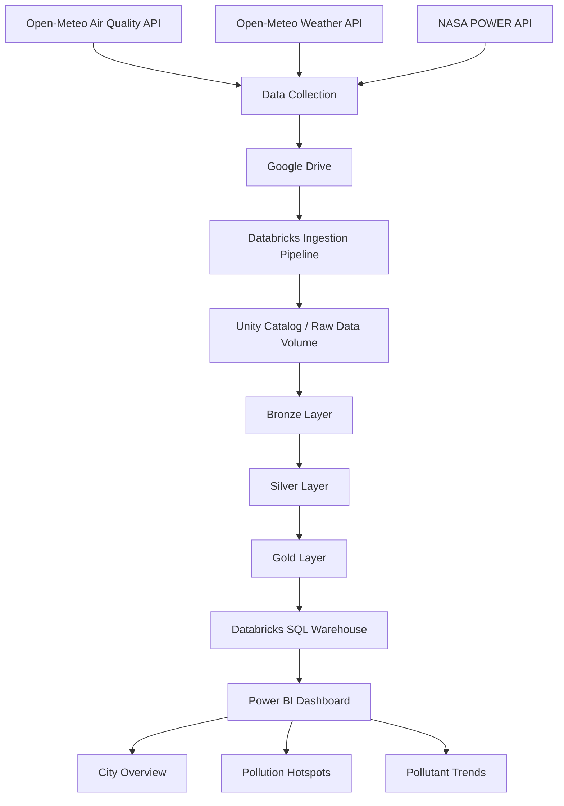
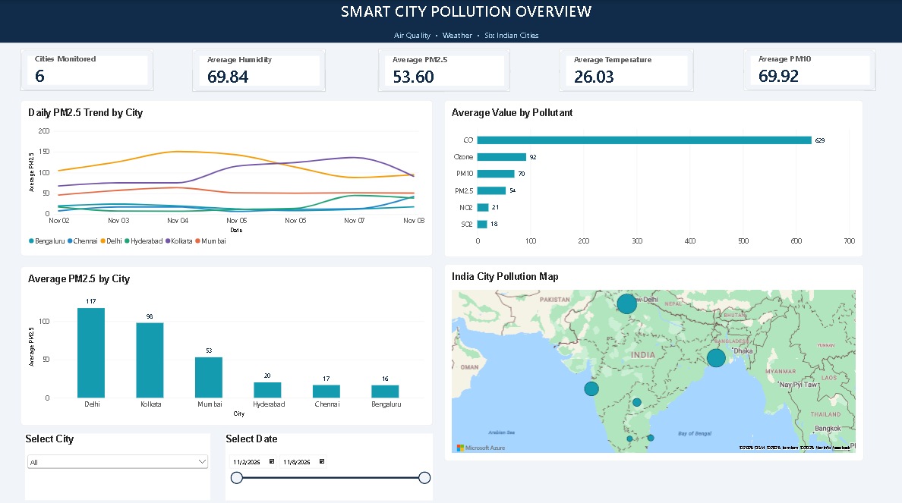
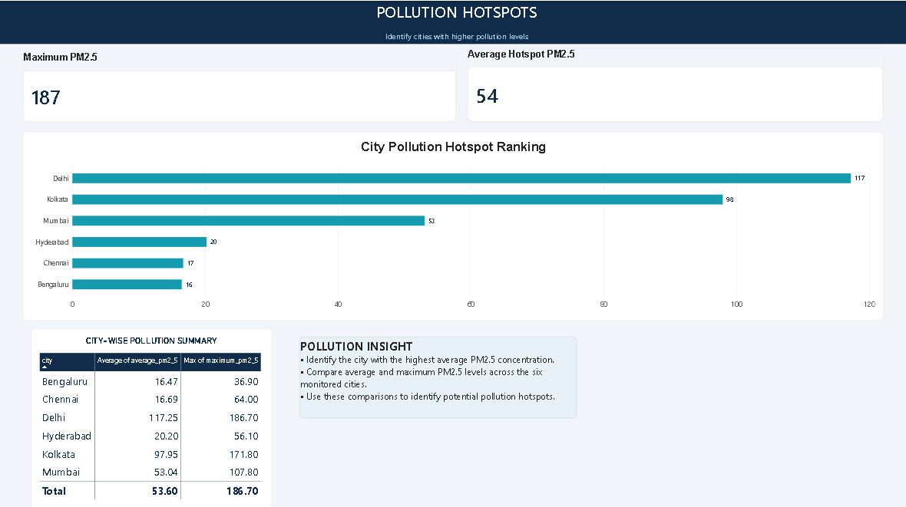
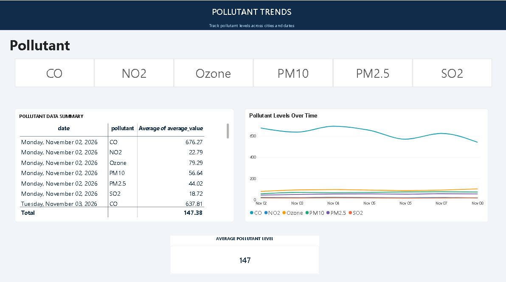

# 🌆 Smart City Pollution Intelligence

### An End-to-End Data Engineering and Business Intelligence Project

**Transforming environmental data into meaningful insights for smarter, healthier cities.**

---

## 📌 Project Overview

Smart City Pollution Intelligence is an end-to-end data engineering and business intelligence project developed to collect, process, analyze, and visualize air pollution and weather-related data across six major Indian metropolitan cities.

The project integrates environmental data from multiple APIs, uses **Google Drive** as part of the data ingestion workflow, processes datasets using **Azure Databricks**, organizes data through a **Medallion Architecture (Bronze, Silver, and Gold)**, and presents analytical insights through an interactive **Power BI dashboard**.

The solution enables users to explore pollution patterns, compare air quality across cities, identify pollution hotspots, and understand pollutant trends.

### 🌍 Cities Covered

- Delhi
- Mumbai
- Bengaluru
- Chennai
- Kolkata
- Hyderabad

---

## 🎯 Project Objectives

- Collect environmental data from multiple external APIs.
- Use Google Drive as part of the data ingestion workflow.
- Build a structured data ingestion process using Databricks.
- Store raw data using Databricks Unity Catalog Volumes.
- Implement Bronze, Silver, and Gold data layers.
- Clean, transform, and organize environmental datasets.
- Develop analytical tables for city-level pollution analysis.
- Implement a Databricks Declarative ETL Pipeline.
- Connect processed data to Power BI.
- Create interactive dashboards for pollution monitoring and comparison.

---

## 🏗️ System Architecture

The project follows an end-to-end data pipeline, from external data collection to business intelligence reporting.

### Architecture Diagram



### 🔄 Data Flow

1. **Data Collection:** Environmental data is retrieved from Open-Meteo and NASA POWER APIs.
2. **File Storage:** Google Drive is used as part of the ingestion workflow to store and organize source data files.
3. **Data Ingestion:** Databricks ingests the configured source data through the project's ingestion workflow.
4. **Data Storage:** Raw data is stored in Databricks Unity Catalog Volumes.
5. **Bronze Layer:** Raw ingested datasets are maintained in Bronze tables.
6. **Silver Layer:** Data is cleaned, structured, and prepared for analysis.
7. **Gold Layer:** Analytical datasets are created for reporting and visualization.
8. **ETL Processing:** The Databricks Declarative ETL Pipeline manages the configured transformation workflow.
9. **Visualization:** Power BI connects to Databricks SQL Warehouse to display interactive reports.

---

## 🛠️ Technologies Used

| Technology | Purpose |
|---|---|
| Python | API integration and data processing |
| Open-Meteo API | Air quality and weather data collection |
| NASA POWER API | Environmental and meteorological data |
| Google Drive | Source file storage and ingestion workflow |
| Azure Databricks | Data engineering and processing |
| Databricks Unity Catalog | Data governance and organization |
| Databricks Volumes | Raw data storage |
| Delta Tables | Structured data storage |
| Declarative ETL Pipeline | Data transformation workflow |
| Databricks SQL Warehouse | Analytical data access |
| Power BI Desktop | Dashboard development |
| DAX | Measures and calculations |
| GitHub | Version control and project documentation |

---

## 🌐 Data Sources

The project uses three external environmental data sources.

### 1. Open-Meteo Air Quality API

Provides air pollution measurements for the selected cities.

**Parameters include:**
- PM2.5
- PM10
- Nitrogen Dioxide (NO₂)
- Sulphur Dioxide (SO₂)
- Carbon Monoxide (CO)
- Ozone (O₃)

Documentation: https://open-meteo.com/en/docs/air-quality-api

### 2. Open-Meteo Weather API

Provides weather information to support environmental analysis.

**Parameters include:**
- Temperature
- Relative humidity
- Wind speed
- Precipitation

Documentation: https://open-meteo.com/en/docs

### 3. NASA POWER API

Provides daily environmental and meteorological data for additional analysis.

Documentation: https://power.larc.nasa.gov/

---

## ☁️ Google Drive Integration

Google Drive is used as part of the project's data ingestion workflow to store and organize source data files before their ingestion into the Databricks environment.

### Role of Google Drive

- Provides a location for storing source data files.
- Helps organize files used in the ingestion workflow.
- Acts as part of the data flow between source data collection and Databricks processing.
- Supports the availability of source files for downstream ingestion.

### Google Drive Ingestion Workflow

1. Environmental data is collected from the configured data sources.
2. Source data files are stored and organized in Google Drive.
3. The Databricks ingestion workflow accesses the configured source files.
4. Data is ingested into the Databricks environment.
5. The ingested data proceeds through the Bronze, Silver, and Gold layers.

**Note:** Google Drive is part of the ingestion workflow. It is distinct from the Databricks Unity Catalog Volume used for raw data storage.

---

## 🧱 Data Engineering: Medallion Architecture

The project uses a three-layer Medallion Architecture to organize data processing.

### 🥉 Bronze Layer — Raw Data

The Bronze layer stores the ingested environmental datasets.

**Tables:**

- `smart_city.pollution.bronze_air_quality`
- `smart_city.pollution.bronze_weather`
- `smart_city.pollution.bronze_nasa_power`

**Purpose:**
- Preserve ingested source data.
- Maintain structured raw datasets.
- Provide a foundation for downstream transformations.

### 🥈 Silver Layer — Cleaned Data

The Silver layer contains processed and structured datasets.

**Declarative ETL Pipeline output tables:**

- `smart_city.pollution_etl.silver_air_quality`
- `smart_city.pollution_etl.silver_weather`
- `smart_city.pollution_etl.silver_nasa_power`

**Purpose:**
- Prepare data for analysis.
- Organize environmental measurements.
- Provide structured datasets for analytical processing.

### 🥇 Gold Layer — Analytical Data

The Gold layer contains datasets designed for reporting and business intelligence.

**Declarative ETL Pipeline output tables:**

- `smart_city.pollution_etl.gold_city_daily`
- `smart_city.pollution_etl.gold_pollution_hotspots`
- `smart_city.pollution_etl.gold_pollutant_trends`

**Purpose:**
- Support city-level pollution analysis.
- Enable hotspot identification.
- Support pollutant trend visualization.
- Provide analytical data for Power BI.

> **Important:** Notebook-generated Silver and Gold tables are maintained under `smart_city.pollution`. They are separate from the Declarative ETL Pipeline output tables maintained under `smart_city.pollution_etl`.

---

## ⚙️ Databricks Implementation

### Unity Catalog Configuration

The project uses the following Unity Catalog structure:

| Component | Name |
|---|---|
| Catalog | `smart_city` |
| Schema | `pollution` |
| Raw Data Volume | `/Volumes/smart_city/pollution/raw_data` |
| ETL Output Schema | `smart_city.pollution_etl` |

### Databricks Declarative ETL Pipeline

**Pipeline Name:** `Smart_city_capstone`

**Pipeline Type:** Ingestion Pipeline

**Output Schema:** `smart_city.pollution_etl`

The pipeline is configured to process environmental datasets and generate Silver and Gold output tables.

The pipeline execution was successfully completed during project implementation.

### Pipeline Output Tables

**Silver:**
- `silver_air_quality`
- `silver_weather`
- `silver_nasa_power`

**Gold:**
- `gold_city_daily`
- `gold_pollution_hotspots`
- `gold_pollutant_trends`

---

## 📊 Power BI Dashboard

The processed data is connected to Power BI through a Databricks SQL Warehouse.

The dashboard is organized into three interactive pages.

### 1. City Overview

Provides a high-level view of air quality and environmental conditions across the six cities.

**Dashboard elements:**
- Average PM2.5
- Average PM10
- Average temperature
- Average humidity
- Daily PM2.5 trend
- City-wise PM2.5 comparison
- Pollutant comparison
- City and date slicers

### 2. Pollution Hotspots

Focuses on identifying and comparing areas with elevated pollution measurements.

**Dashboard elements:**
- Hotspot average PM2.5
- Hotspot maximum PM2.5
- City-wise pollution comparison
- Hotspot summary table

### 3. Pollutant Trends

Provides a view of pollutant behavior over time.

**Dashboard elements:**
- Pollutant trend line chart
- Pollutant selection slicer
- Average pollutant value
- Time-based trend analysis

### 📷 Dashboard Preview

Add your actual Power BI screenshots to the repository and update the image paths below.

**City Overview**



**Pollution Hotspots**



**Pollutant Trends**



---

## 📐 DAX Measures

The Power BI report includes the following ten DAX measures:

1. Average PM2.5
2. Average PM10
3. Average Temperature
4. Average Humidity
5. Maximum PM2.5
6. Cities Monitored
7. Total Air Quality Readings
8. Average Pollutant Value
9. Hotspot Average PM2.5
10. Hotspot Maximum PM2.5

These measures support KPI cards, comparisons, and analytical visualizations.

---

## 📁 Repository Structure

```text
Smart-City-Pollution-Intelligence/
│
├── README.md
│
├── Databricks/
│   ├── API_Data_Extraction.py
│   ├── Bronze_Layer.py
│   ├── Silver_Layer.py
│   ├── Gold_Layer.py
│   └── Pipeline_Documentation.md
│
├── PowerBI/
│   ├── Smart_City_Dashboard.pbix
│   └── Dashboard_Screenshots/
│       ├── City_Overview.png
│       ├── Pollution_Hotspots.png
│       └── Pollutant_Trends.png
│
├── Presentation/
│   └── Smart_City_Pollution_Intelligence_Presentation.pptx
│
├── Documentation/
│   ├── Architecture.png
│   └── Data_Sources.md
│
└── Screenshots/
    ├── Databricks_Pipeline.png
    ├── Bronze_Tables.png
    ├── Silver_Tables.png
    └── Gold_Tables.png
```

*The filenames represent the recommended repository organization. Update them to match the actual files uploaded.*

---

## 🚀 How to Explore the Project

### Prerequisites

- Python
- An Azure Databricks workspace
- Access to Databricks Unity Catalog
- Databricks SQL Warehouse access
- Google Drive access to the configured source files
- Power BI Desktop
- Git and GitHub

### Step 1: Clone the Repository

```bash
git clone https://github.com/YOUR_USERNAME/Smart-City-Pollution-Intelligence.git
```

### Step 2: Open the Databricks Notebooks

Import the notebooks from the `Databricks/` directory into your Databricks workspace.

Configure the required API parameters, source file locations, and storage settings according to your environment.

### Step 3: Configure Google Drive

Ensure the required source files are available in the configured Google Drive location and that the ingestion workflow has the necessary access.

### Step 4: Configure Databricks Storage

Ensure the Unity Catalog catalog, schema, and volume are available:

```text
Catalog: smart_city
Schema: pollution
Volume: raw_data
```

### Step 5: Execute the Data Workflow

Run the data ingestion and transformation notebooks or configured pipeline workflow in the appropriate order.

Review the Bronze, Silver, and Gold datasets after execution.

### Step 6: Review the ETL Pipeline

Open the Databricks Declarative ETL Pipeline named:

```text
Smart_city_capstone
```

Review its execution status, data flow graph, and output tables.

### Step 7: Open the Power BI Dashboard

Open the `.pbix` file from the `PowerBI/` directory.

Configure the Databricks connection and required credentials to access the analytical datasets.

---

## 📈 Project Outcomes

The project demonstrates an end-to-end implementation of an environmental data analytics workflow.

**Key deliverables include:**

- Integration of three environmental data sources.
- Coverage of six major Indian cities.
- Google Drive integration in the data ingestion workflow.
- Databricks-based data ingestion and processing.
- Unity Catalog-based data organization.
- Bronze, Silver, and Gold data layers.
- A Databricks Declarative ETL Pipeline.
- Analytical Gold datasets for pollution reporting.
- Ten Power BI DAX measures.
- Three interactive Power BI dashboard pages.

---

## ⚠️ Limitations

- The analysis depends on the availability and quality of external API data.
- Data coverage may vary depending on API availability and selected locations.
- Environmental measurements should be interpreted with their source, units, timestamps, and measurement context.
- The dashboard provides analytical insights and is not a substitute for official regulatory air-quality monitoring.
- Actual pollution rankings and conclusions should be based on validated data from the executed datasets.
- Google Drive file availability and access permissions may affect ingestion.

---

## 🔮 Future Enhancements

Potential improvements include:

- Adding real-time or scheduled data ingestion.
- Expanding coverage to additional Indian cities.
- Implementing automated data quality checks.
- Adding historical pollution comparisons.
- Integrating official monitoring station datasets.
- Developing pollution forecasting models.
- Adding geographical pollution maps.
- Implementing automated alerts for elevated pollution levels.
- Improving pipeline monitoring and error handling.

---

## 👥 Team

**Project Name:** Smart City Pollution Intelligence

**Project Type:** Academic Capstone Project

**Team Size:** 3 Members

### Team Contributions

Add the actual names and responsibilities of all three team members.

**Team Lead:** **Ansh kumar**

---

## 📚 References

- Open-Meteo Air Quality API: https://open-meteo.com/en/docs/air-quality-api
- Open-Meteo Weather API: https://open-meteo.com/en/docs
- NASA POWER: https://power.larc.nasa.gov/
- Google Drive: https://drive.google.com/
- Databricks Documentation: https://docs.databricks.com/
- Microsoft Power BI Documentation: https://learn.microsoft.com/en-us/power-bi/

---

## ⭐ Acknowledgement

This project was developed as an academic capstone project to demonstrate practical applications of data engineering, cloud-based data processing, environmental data analysis, and business intelligence.

It brings together external environmental data sources, Google Drive, Databricks, and Power BI to demonstrate how data-driven solutions can support environmental monitoring and smarter cities.

---

### 🌱 Smart City Pollution Intelligence

**Turning Environmental Data into Meaningful Insights.**
